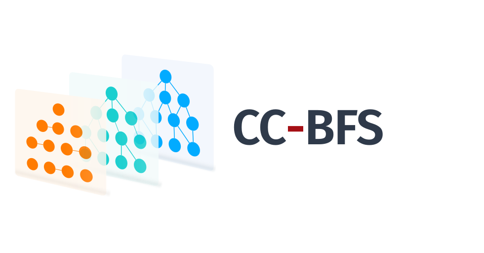

# CC-BFS: Accelerating All-Pairs Shortest Path Computation via Dynamic Programming Informed by Network Science

<p align="center">
  
</p>

Cannistraci–Chen breadth-first search (CC-BFS) computes exact all-pairs shortest-path (APSP) distances in unweighted, undirected networks. It uses network-science-informed prioritization and memoization to reduce repeated work across breadth-first searches. **CC-BFS-P** is the shared-memory parallel version: it distributes hub preprocessing and source searches across OpenMP threads.

The algorithms are implemented in C++ and can be called from MATLAB (MEX) and Python (`ctypes`).

## Algorithms

| Algorithm | Computes | MATLAB | Python |
|-----------|----------|--------|--------|
| ZM-BFS (Zuse–Moore BFS) | APSP  | `bfs_apsp_l_cpp` | `bfs_apsp` |
| CC-BFS | APSP | `cc_bfs_apsp_l_cpp` | `cc_bfs_apsp` |
| CC-BFS-P | APSP, shared-memory parallel | `cc_bfs_p` | `cc_bfs_p_apsp` |
| ESS (ExactSumSweep) | Diameter and radius | `ess_cpp` | `ess` |
| CC-ESS | Diameter and radius| `cc_ess_cpp` | `cc_ess` |
| DO-BFS (third-party baseline) | APSP | `do_bfs_gapbs_apsp_l_cpp` | `do_bfs_apsp` |


## Input requirements

Every algorithm expects a nonempty, square, symmetric adjacency matrix whose entries are 0 or 1, that is, an unweighted, undirected graph. All algorithms also require the graph to be connected. For disconnected graphs, extract their connected components as input. The interfaces do not check every condition, so check your matrix before calling them.

## Platform support

| Interface | Windows x64 | Linux | macOS |
|-----------|-------------|-------|-------|
| [C++](docs/CPP_INTERFACE.md) | Compile the sources with MSVC | Compile the sources with GCC | Untested |
| [Python](docs/PYTHON_INTERFACE.md) | Prebuilt DLLs included; MSVC build script | Build the shared libraries with the supplied script | Untested; no build script |
| [MATLAB](docs/MATLAB_MEX_INTERFACE.md) | Prebuilt MEX files included; MSVC build script | No supplied or tested MEX build | Untested; no build script |

Setup and build steps are in the [Installation Guide](docs/INSTALL.md).

## Quick start

### C++

Compile the CC-BFS source together with your program. You need a C++17 compiler and Eigen 3.3 or later.

```cpp
// main.cpp
#include "cc_bfs_apsp_l.h"
#include <iostream>

int main() {
    Eigen::MatrixXd adj(4, 4);   // A 4-cycle: 0-1-3-2-0
    adj << 0, 1, 1, 0,
           1, 0, 0, 1,
           1, 0, 0, 1,
           0, 1, 1, 0;
    MatrixType graph = adj;      // emptied by the call
    RESULT result = CC_BFS_APSP_L(graph, "bounded-avg-deg", /*nd=*/false, /*verbose=*/false);

    // result.D holds the native unsigned matrix; it is converted to double only for printing.
    std::cout << ResultMatrixToDouble(result.D) << "\n"
              << "native type: " << result.counters.data_type << "\n"
              << result.computation_time << " s\n";
}
```

With GCC, from the repository root:

```bash
g++ -std=c++17 -O2 -I/path/to/eigen-3.4.0 -Isource/cpp main.cpp source/cpp/cc_bfs_apsp_l_cpp.cpp -o cc_bfs_example
./cc_bfs_example
```

The MSVC command is in the [Installation Guide](docs/INSTALL.md#c), and the other algorithms' entry points are in the [C++ interface](docs/CPP_INTERFACE.md) reference.

### Python

On Windows x64 the prebuilt libraries work as shipped. On Linux, [build them first](docs/INSTALL.md#2-get-the-native-libraries). The package is not pip-installable; add `source/python` to the import path.

```python
import sys
from pathlib import Path

import numpy as np
from scipy import sparse

sys.path.insert(0, str(Path("source/python").resolve()))  # run from the repository root
from fast_apsp import cc_bfs_apsp, cc_bfs_p_apsp

# A 4-cycle: 0-1-3-2-0
adj = np.array([[0, 1, 1, 0],
                [1, 0, 0, 1],
                [1, 0, 0, 1],
                [0, 1, 1, 0]])

result = cc_bfs_apsp(adj)
D = result["distances"]          # 4-by-4 hop distances
print(D, D.dtype)                # native unsigned type, uint8 here
print(result["elapsed_time"])    # native computation time in seconds

# CC-BFS-P accepts SciPy sparse input without densifying the adjacency matrix.
result_p = cc_bfs_p_apsp(sparse.csr_matrix(adj), num_threads=2)
```

### MATLAB

The prebuilt Windows x64 MEX files are in `source/matlab/mex_functions/`.

```matlab
% From the repository root
addpath(fullfile(pwd, 'source', 'matlab', 'mex_functions'));

A = sparse([0 1 1 0; 1 0 0 1; 1 0 0 1; 0 1 1 0]);   % 4-cycle

[D, t] = cc_bfs_apsp_l_cpp(A, 'nv');     % 'nv' suppresses progress output
[Dp, tp] = cc_bfs_p(A, 2, 'nv');         % 2 OpenMP threads
[diameter, radius] = cc_ess_cpp(A, 4);   % 4 initial sweeps
```

Pass options such as `'nv'` as single-quoted character vectors. See [MATLAB calling conventions](docs/MATLAB_MEX_INTERFACE.md#calling-conventions).

## Documentation

- [Installation Guide](docs/INSTALL.md): requirements, prebuilt binaries, building and troubleshooting.
- [C++ interface](docs/CPP_INTERFACE.md): entry points, inputs, outputs and linking rules.
- [Python interface](docs/PYTHON_INTERFACE.md): functions, inputs, outputs, memory, timing and threads.
- [MATLAB MEX interface](docs/MATLAB_MEX_INTERFACE.md): functions, options, outputs, timing and memory counters.
- [Benchmarking](docs/BENCHMARKING.md): the MATLAB and Python comparison scripts and the artificial benchmark networks.

## Benchmarking

`scripts/benchmark_apsp_on_examples.m` and `scripts/benchmark_apsp_on_examples.py` time ZM-BFS, CC-BFS, CC-BFS-P and DO-BFS on every `.mat` network in a folder; the default folder is the bundled `data/example_networks/`, which includes some small real-world networks. The full benchmark collection used in the article is not bundled because of its size; please refer to the article for the datasets. [BENCHMARKING.md](docs/BENCHMARKING.md) explains how to generate the artificial networks, switch folders and read the results.

## Third-party baseline (DO-BFS)

The first-class algorithms maintained here are ZM-BFS, CC-BFS, CC-BFS-P, ESS and CC-ESS. For benchmarking convenience and reproducibility, the sequential Direction-Optimizing BFS (DO-BFS) implementation adapted from the [GAP Benchmark Suite (GAPBS)](https://github.com/sbeamer/gapbs) is bundled under `third_party/gapbs-do-bfs/`. It is a third-party APSP baseline governed by `third_party/gapbs-do-bfs/LICENSE.txt`, not a project contribution. Parallel comparator implementations are not distributed in this release.

## References

- **ZM-BFS**: Zuse, K. Der Plankalkül, Konrad Zuse Internet Archive. (1972); Moore, E. F. The shortest path through a maze. in *Proc. of the International Symposium on the Theory of Switching* 285–292 (Harvard University Press, 1959).

- **DO-BFS**: Beamer, S., Asanović, K. & Patterson, D. Direction-Optimizing Breadth-First Search. Scientific Programming 21, 702694 (2013).

- **ExactSumSweep**: Borassi, M. et al. Fast diameter and radius BFS-based computation in (weakly connected) real-world graphs. With an application to the six degrees of separation games. Theoretical Computer Science 586, 59–80 (2015).

## Citation

If you use this code in your research, please cite:

```bibtex
@unpublished{chen2026cc_bfs,
  title={Accelerating All-Pairs Shortest Path Computation via Dynamic Programming Informed by Network Science},
  author={Chen, Junda and Cannistraci, Carlo Vittorio},
  note={Manuscript in preparation},
  year={2026}
}
```

## License

This project is licensed under the **Apache License 2.0**; see [LICENSE](LICENSE) for the full text. See [THIRD_PARTY_NOTICES.md](THIRD_PARTY_NOTICES.md) for reused third-party components.

The bundled third-party DO-BFS baseline under `third_party/gapbs-do-bfs/` is derived from the [GAP Benchmark Suite](https://github.com/sbeamer/gapbs) and is governed by its own license in `third_party/gapbs-do-bfs/LICENSE.txt`.

## Contact

For questions or issues, please open an issue on the GitHub repository.

- Email: kalokagathos.agon@gmail.com
